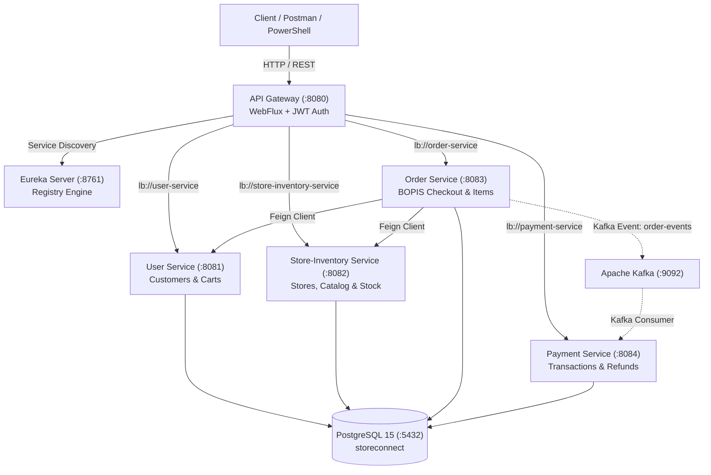

# StoreConnect: Omnichannel Retail Microservices Platform
## Comprehensive Demo Walkthrough, Architecture Rationale & Evaluation Guide

> **Stack**: Java 25 (OpenJDK 25.0.3) | Spring Boot 4.1.1 | Spring Cloud 2025.1.3 | PostgreSQL 15 | Apache Kafka | Netflix Eureka | Spring Cloud Gateway (WebFlux) | Zero-Docker Native Host

---

## Table of Contents
1. [Executive Summary & The 60-Second Elevator Pitch](#1-executive-summary--the-60-second-elevator-pitch)
2. [End-to-End Customer Flow (The Presentation Script)](#2-end-to-end-customer-flow-the-presentation-script)
3. [Architecture Decisions & Design Patterns](#3-architecture-decisions--design-patterns)
4. [Critical Syntax & Tricky Areas Where You Could Face Questions](#4-critical-syntax--tricky-areas-where-you-could-face-questions)
5. [Evaluation / Interview Q&A (Decisions Made By You)](#5-evaluation--interview-qa-decisions-made-by-you)
6. [Live Demo Checklist & SQL Verification Cheat Sheet](#6-live-demo-checklist--sql-verification-cheat-sheet)

---

## 1. Executive Summary & The 60-Second Elevator Pitch

### What is StoreConnect?
**StoreConnect** is an enterprise-grade, distributed omnichannel retail platform that unifies online e-commerce with physical retail stores. It enables **BOPIS (Buy Online, Pick-up In Store)**, real-time store-level inventory reservation, centralized shopping carts, and event-driven order processing across 6 microservices.

### The Elevator Pitch (What to Say in the First 60 Seconds)
> *"Judges and Mentors, traditional e-commerce platforms decouple warehouse inventory from physical stores, resulting in stockouts and delayed fulfillment. StoreConnect solves this through a real-time omnichannel microservices architecture.*
> 
> *Our system is built on **Spring Boot 4.1.1** and **Java 25**, orchestrated by a reactive **Spring Cloud Gateway** and **Netflix Eureka Service Discovery**. When a customer places a BOPIS order, StoreConnect executes an atomic two-phase inventory reservation at the customer's selected physical store, creates the order using transactional cascade persistence, and broadcasts decoupled order events via **Apache Kafka**—all backed by multi-tenant schema isolation in **PostgreSQL 15** without container overhead."*



---

## 2. End-to-End Customer Flow (The Presentation Script)

Walk your mentors through this step-by-step lifecycle. This matches the exact script run in [`run-all-and-test.ps1`](file:///d:/PS_CPS_Project/run-all-and-test.ps1).

### Step 1: Customer Registration & Password Hashing
- **Client Request**: `POST http://localhost:8080/api/auth/register`
- **Routing**: API Gateway identifies the route `user-auth` mapped to predicate `/api/auth/**` and forwards downstream to `lb://user-service`.
- **Code Execution**:
  - [AuthController.java](file:///d:/PS_CPS_Project/user-service/src/main/java/com/storeconnect/user/controller/AuthController.java#L29-L32) receives `@Valid @RequestBody RegisterRequest`.
  - [AuthService.java](file:///d:/PS_CPS_Project/user-service/src/main/java/com/storeconnect/user/service/AuthService.java) checks `customerRepository.existsByEmail(request.email())`.
  - Hashes raw password using `BCryptPasswordEncoder(strength = 12)`.
  - Persists record into PostgreSQL table `user_schema.customers`.
  - Generates signed HMAC-SHA256 JWT access token.

### Step 2: Customer Authentication & Token Generation
- **Client Request**: `POST http://localhost:8080/api/auth/login`
- **Code Execution**:
  - `passwordEncoder.matches(request.password(), customer.getPasswordHash())` validates credentials.
  - Returns `AuthResponse(token, expiresIn, CustomerDTO)`.

### Step 3: API Gateway JWT Filtering & Claims Enrichment
- **Class**: [JwtAuthGlobalFilter.java](file:///d:/PS_CPS_Project/api-gateway/src/main/java/com/storeconnect/gateway/config/JwtAuthGlobalFilter.java#L45-L94)
- **Mechanism**:
  - The Gateway intercepts every downstream request.
  - If endpoint is public (e.g. `/api/auth/**`, `GET /api/products`), it allows execution immediately.
  - For protected routes, it extracts `Authorization: Bearer <token>`, validates the cryptographic signature using HMAC-SHA256 secret key, and decodes the claims.
  - **Downstream Mutation**: It injects `X-User-Id`, `X-User-Role`, and `X-User-Email` HTTP headers into the mutated downstream exchange, so microservices never have to re-verify cryptographic tokens!

### Step 4: Browsing Store Catalog & Real-Time Stock Check
- **Client Requests**:
  - `GET /api/stores` ➡️ Lists physical retail locations (e.g., `STORE-GGN-01` in Gurugram).
  - `GET /api/products` ➡️ Lists products (e.g., `PROD-AUD-001`, Sony WH-1000XM5).
  - `GET /api/inventory/store/STORE-GGN-01/product/PROD-AUD-001` ➡️ Reads `quantity_available` (11) and `quantity_reserved` (4).

### Step 5: Shopping Cart Management
- **Client Request**: `POST /api/cart/items` with payload `{ productId: "PROD-AUD-001", quantity: 1, storeId: "STORE-GGN-01" }`.
- **Code Execution**:
  - [CartController.java](file:///d:/PS_CPS_Project/user-service/src/main/java/com/storeconnect/user/controller/CartController.java) reads the authenticated `X-User-Id`.
  - [CartService.java](file:///d:/PS_CPS_Project/user-service/src/main/java/com/storeconnect/user/service/CartService.java) calls `InventoryFeignClient.getProductById(productId)` to obtain the live price (INR 29,990.00).
  - Persists line item in `user_schema.cart_items` and updates total in `user_schema.carts`.

### Step 6: BOPIS Checkout & Atomic Inventory Reservation
- **Client Request**: `POST /api/orders/checkout` with payload `{ storeId: "STORE-GGN-01", fulfillmentType: "STORE_PICKUP" }`.
- **Code Execution in [OrderService.java](file:///d:/PS_CPS_Project/order-service/src/main/java/com/storeconnect/order/service/OrderService.java#L56-L176)**:
  1. Calls `UserFeignClient.getCart(customerId)` to fetch cart items.
  2. Calls `InventoryFeignClient.validateStock(...)` to guarantee store stock availability.
  3. Constructs `Order` and associated `OrderItem` entities.
  4. Persists the order with `CascadeType.ALL` into `order_schema.orders` and `order_schema.order_items`.
  5. Executes synchronous atomic stock reservation via `InventoryFeignClient.reserveStock(...)`:
     ```sql
     UPDATE inventory_schema.store_inventory 
     SET quantity_available = quantity_available - 1, 
         quantity_reserved = quantity_reserved + 1 
     WHERE store_id = 'STORE-GGN-01' AND product_id = 'PROD-AUD-001';
     ```
  6. Calls `UserFeignClient.clearCart(customerId)` to empty the cart.
  7. Publishes `ORDER_PLACED` event to Kafka topic `order-events` with graceful fallback if broker is offline.

---

## 3. Architecture Decisions & Design Patterns

During the presentation, explain the deliberate design patterns you chose:

### 1. API Gateway Pattern
- **Component**: `api-gateway`
- **Why**: Instead of exposing 5 ports (`8081`, `8082`, `8083`, `8084`, `8761`) to mobile/web clients, the Gateway provides a single entry point on port `8080`.
- **Key Decision**: We implemented programmatic Java DSL routing via [GatewayRoutesConfig.java](file:///d:/PS_CPS_Project/api-gateway/src/main/java/com/storeconnect/gateway/config/GatewayRoutesConfig.java) using `RouteLocatorBuilder` rather than brittle YAML routing:
  ```java
  @Bean
  public RouteLocator customRouteLocator(RouteLocatorBuilder builder) {
      return builder.routes()
              .route("user-auth", r -> r.path("/api/auth/**").uri("lb://user-service"))
              .route("order-service", r -> r.path("/api/orders/**").uri("lb://order-service"))
              .build();
  }
  ```
- **Benefit**: Type safety, zero YAML indentation bugs, and dynamic integration with Spring Cloud LoadBalancer.

### 2. Service Discovery Pattern (Client-Side Load Balancing)
- **Component**: `eureka-server` + `spring-cloud-starter-loadbalancer`
- **Why**: Services boot with dynamic IPs/ports. The Gateway and Feign clients use virtual URIs like `lb://store-inventory-service`. Eureka continuously resolves instances and LoadBalancer distributes traffic without hardcoding hostnames.

### 3. Database per Service (Schema Isolation Pattern)
- **Component**: PostgreSQL 15 `storeconnect` database
- **Why**: Rather than maintaining a tangled monolith database or having to pay overhead for 4 separate physical DB instances, we used **PostgreSQL Schema Isolation**:
  - `user_schema` (Customers, Carts, Cart Items)
  - `inventory_schema` (Categories, Products, Stores, Store Inventory)
  - `order_schema` (Orders, Order Items)
  - `payment_schema` (Payments, Transactions)
- **Benefit**: Strict logical boundary separation; services cannot query tables across schemas without going through REST APIs.

### 4. Repository & DTO Patterns
- **Why**: Entities represent PostgreSQL persistence models. DTOs (Data Transfer Objects) represent API contracts. By isolating them and mapping in the service layer, database refactoring never breaks external API clients.

### 5. Asynchronous Event-Driven Architecture (Kafka)
- **Component**: `order-service` (Producer) and `payment-service` (Consumer)
- **Why**: Orders must not be delayed by synchronous third-party payment gateways. Order creation triggers an asynchronous `ORDER_PLACED` event. If Kafka is temporarily unavailable, the order creation completes gracefully via Feign synchronous reservation and logs a non-blocking warning.

### 6. Centralized Exception Handling Pattern
- **Component**: [GlobalExceptionHandler.java](file:///d:/PS_CPS_Project/user-service/src/main/java/com/storeconnect/user/exception/GlobalExceptionHandler.java)
- **Why**: Standardizes all 4xx and 5xx errors into a predictable RFC-7807 compliant structure across all services (`timestamp`, `status`, `error`, `message`, `path`, `correlationId`).

---

## 4. Critical Syntax & Tricky Areas Where You Could Face Questions

These are the precise code snippets interviewers and evaluators inspect:

### A. `@RestControllerAdvice` and Exception Hierarchy
In [GlobalExceptionHandler.java](file:///d:/PS_CPS_Project/user-service/src/main/java/com/storeconnect/user/exception/GlobalExceptionHandler.java):
```java
@ExceptionHandler(StoreConnectException.class)
public ResponseEntity<ApiErrorResponse> handleStoreConnectException(StoreConnectException ex, HttpServletRequest request) {
    ApiErrorResponse error = new ApiErrorResponse(
            LocalDateTime.now(),
            ex.getStatus().value(),
            ex.getStatus().getReasonPhrase(),
            ex.getMessage(),
            request.getRequestURI(),
            UUID.randomUUID().toString()
    );
    return ResponseEntity.status(ex.getStatus()).body(error);
}
```
- **Gotcha to explain**: Why create a base `StoreConnectException`?
- **Answer**: By subclassing all domain exceptions (e.g. `UserNotFoundException`, `CartItemNotFoundException`, `DuplicateEmailException`) from an abstract `StoreConnectException` that carries an `HttpStatus`, we eliminate dozens of repetitive exception handler methods and centralize HTTP status code mapping in the exception class constructor itself!

### B. Java 25 & Spring Boot 4 Record Types and Pattern Matching
Across our DTOs (e.g., `RegisterRequest.java`, `StockValidateRequest.java`):
```java
public record RegisterRequest(
    @NotBlank(message = "Email is required") @Email String email,
    @NotBlank(message = "Password is required") String password,
    String firstName,
    String lastName
) {}
```
- **Gotcha to explain**: Why use `record` instead of `class`?
- **Answer**: Records are immutable, inherently thread-safe, generate canonical constructors, `equals()`, `hashCode()`, and `toString()` at compile-time with zero boilerplate, and integrate natively with Jackson serialization in Spring Boot 4.

### C. Modern JPA Cascade Persistence vs NonUniqueObjectException
In [OrderService.java](file:///d:/PS_CPS_Project/order-service/src/main/java/com/storeconnect/order/service/OrderService.java#L121-L137):
```java
List<OrderItem> orderItems = new ArrayList<>();
for (CartDTO.CartItemDTO item : cart.items()) {
    OrderItem orderItem = OrderItem.builder()
            .order(order)
            .productId(item.productId())
            .quantity(item.quantity())
            .unitPrice(item.unitPrice())
            .subtotal(item.subtotal())
            .build();
    orderItems.add(orderItem);
}
order.setItems(orderItems);

Order savedOrder = orderRepository.save(order); // Cascades to all OrderItems!
```
- **Gotcha to explain**: Why NOT call `orderItemRepository.saveAll(orderItems)` separately?
- **Answer**: In Hibernate 7, calling `saveAll` on child items while the parent entity has `CascadeType.ALL` can trigger a `NonUniqueObjectException` (entity attached twice to the persistence context). Attaching children to `order.setItems()` and saving the parent order once delegates cascade lifecycle management cleanly to JPA.

### D. Hibernate 7 Auto-Dialect Discovery
In our `application.yaml` files, notice that `spring.jpa.properties.hibernate.dialect` is completely omitted!
- **Gotcha to explain**: Why is dialect missing?
- **Answer**: In Hibernate 7 (Spring Boot 4), specifying `org.hibernate.dialect.PostgreSQLDialect` triggers deprecation warning `HHH90000025`. Hibernate automatically reads JDBC connection metadata from the PostgreSQL driver and configures dialect features specifically for the connected version (PostgreSQL 15.13).

### E. Spring Cloud Gateway Reactive Non-Blocking Thread Model
In [JwtAuthGlobalFilter.java](file:///d:/PS_CPS_Project/api-gateway/src/main/java/com/storeconnect/gateway/config/JwtAuthGlobalFilter.java):
```java
@Override
public Mono<Void> filter(ServerWebExchange exchange, GatewayFilterChain chain) {
    ...
    return chain.filter(exchange.mutate().request(mutatedRequest).build());
}
```
- **Gotcha to explain**: Why `Mono<Void>` and `ServerWebExchange` instead of `HttpServletRequest` and `doFilter()`?
- **Answer**: `api-gateway` runs on reactive **Project Reactor** and **Netty**, not Tomcat servlets. Blocking calls like `Thread.sleep()` or synchronous servlet filters would starve the Netty event loop. Using `Mono<Void>` allows asynchronous, non-blocking request pipelines handling thousands of concurrent requests on a minimal thread pool.

---

## 5. Evaluation / Interview Q&A (Decisions Made By You)

Here are the exact questions mentors or evaluators will challenge you with, and the exact answers to give:

### Q1: "Why did you build microservices instead of a monolithic architecture?"
> **Your Answer**: 
> *"A monolithic retail system couples catalog browsing with high-volume checkout. During peak traffic (like flash sales), catalog queries would saturate DB connection pools and block checkout. By decoupling into Store-Inventory and Order services, inventory checks scale independently, checkout remains isolated, and inventory can be reserved at store level without locking user carts."*

### Q2: "Why separate schemas in PostgreSQL instead of completely different databases?"
> **Your Answer**:
> *"In a production enterprise architecture, running 5 separate physical database instances incurs high operational overhead and licensing costs during early deployment. We chose **PostgreSQL Multi-Schema Isolation** (`user_schema`, `inventory_schema`, `order_schema`, `payment_schema`). Each microservice's DataSource is bound strictly to its own schema via `?currentSchema=...`. Microservices cannot access foreign schemas directly, maintaining strict bounded contexts while keeping database maintenance lightweight."*

### Q3: "Why did you use Java DSL RouteLocatorBuilder instead of YAML routes in the API Gateway?"
> **Your Answer**:
> *"In Spring Cloud 2025.1.3 (Spring Boot 4), YAML path predicates often suffer from subtle whitespace parsing discrepancies (such as space after commas) that silently fail to match routes. Programmatic Java DSL configuration via `RouteLocatorBuilder` gives us compile-time verification, direct integration with Spring Cloud LoadBalancer, and full visibility with log tracing at startup."*

### Q4: "Why use Lombok `@Data` instead of explicit `@Getter` and `@Setter`?"
> **Your Answer**:
> *"Lombok's `@Data` is a composite annotation that bundles `@Getter`, `@Setter`, `@ToString`, `@EqualsAndHashCode`, and `@RequiredArgsConstructor`. Using separate `@Getter` and `@Setter` creates unnecessary duplication. `@Data` keeps our domain models clean and concise."*

### Q5: "How does the system ensure atomicity during Store Pickup (BOPIS) checkout?"
> **Your Answer**:
> *"When checkout is initiated, [OrderService.java](file:///d:/PS_CPS_Project/order-service/src/main/java/com/storeconnect/order/service/OrderService.java) executes a multi-step sequence within a Spring `@Transactional` context. It calls the Store-Inventory Service via Feign, which executes an atomic SQL update decremeting `quantity_available` and incrementing `quantity_reserved`. If the available quantity is insufficient, it throws a `CheckoutFailedException` with an HTTP 400 status, preventing overselling."*

### Q6: "What happens if Kafka is down during order placement?"
> **Your Answer**:
> *"Our Kafka producer in [OrderEventProducer.java](file:///d:/PS_CPS_Project/order-service/src/main/java/com/storeconnect/order/kafka/OrderEventProducer.java) uses a fail-safe try-catch pattern. The core transactional order creation and physical stock reservation are already completed synchronously in PostgreSQL. If the Kafka cluster is offline, the producer catches the timeout exception, logs a warning, and safely returns the created order to the client, ensuring the customer is never blocked by message broker downtime."*

---

## 6. Live Demo Checklist & SQL Verification Cheat Sheet

Before and during your live demo, follow these exact steps:

### 1. Run the Full Automated Verification
Execute the master PowerShell runner from the project root:
```powershell
powershell -ExecutionPolicy Bypass -File .\run-all-and-test.ps1
```

### 2. Live PostgreSQL Queries (For Proof of Database Persistence)
Open a terminal and run `psql` to show the database records:
```powershell
$env:PGPASSWORD = "JaiShriRam321@"
& "C:\Program Files\PostgreSQL\15\bin\psql.exe" -U postgres -d storeconnect -h 127.0.0.1
```

Run these SQL queries during the presentation:

```sql
-- 1. Show the latest registered customer
SELECT id, email, first_name, last_name, role, created_at 
FROM user_schema.customers 
ORDER BY created_at DESC LIMIT 1;

-- 2. Show the customer's shopping cart record
SELECT id, customer_id, store_id, updated_at 
FROM user_schema.carts 
ORDER BY updated_at DESC LIMIT 1;

-- 3. Show the placed BOPIS order
SELECT id, order_number, customer_id, store_id, status, fulfillment_type, total_amount, created_at 
FROM order_schema.orders 
ORDER BY created_at DESC LIMIT 1;

-- 4. Show the order line items
SELECT id, order_id, product_id, quantity, unit_price, subtotal 
FROM order_schema.order_items 
ORDER BY id DESC LIMIT 1;

-- 5. Show real-time store inventory reservation status
SELECT store_id, product_id, quantity_available, quantity_reserved, updated_at 
FROM inventory_schema.store_inventory 
WHERE store_id = 'STORE-GGN-01';
```

---
*Created for StoreConnect Omnichannel Architecture Presentation & Demo.*
