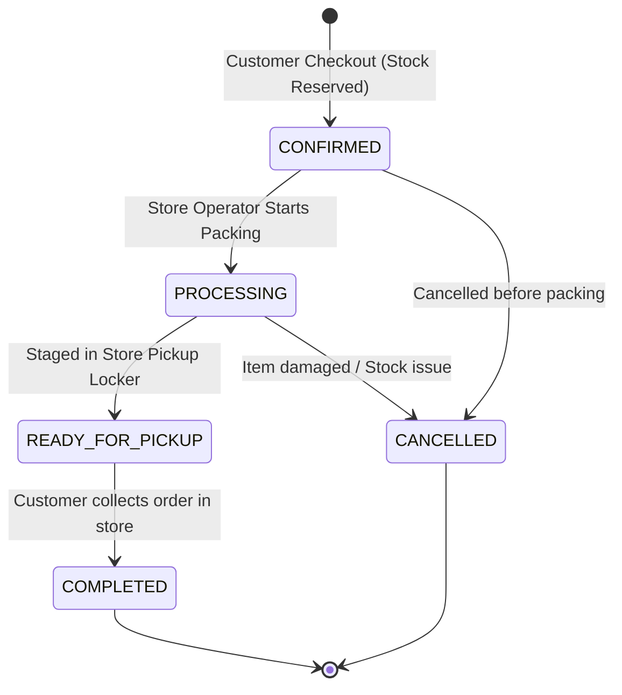

# StoreConnect – Microservice Architecture & Class Diagram

> **How to render:** Open this file in VS Code with the "Markdown Preview Mermaid Support" extension, or paste the mermaid block into [mermaid.live](https://mermaid.live).

---

## 1. Microservice-Partitioned Class Diagram

The following diagram details the classes, entities, DTOs, Feign clients, and asynchronous Kafka event publishers across our 3 business microservices:

```mermaid
classDiagram
    direction TB

    %% ==========================================
    %% USER SERVICE (user_schema - Port 8081)
    %% ==========================================
    namespace UserService {
        class Customer {
            -String id
            -String firstName
            -String lastName
            -String email
            -String phone
            -String address
            -String passwordHash
            -String role
            -LocalDateTime createdAt
            +getId() String
            +getEmail() String
            +getRole() String
        }

        class Cart {
            -String id
            -String customerId
            -String storeId
            -BigDecimal totalAmount
            -LocalDateTime createdAt
            -LocalDateTime updatedAt
            +addItem(CartItem) void
            +removeItem(String itemId) void
            +clear() void
        }

        class CartItem {
            -String id
            -String cartId
            -String productId
            -int quantity
            -BigDecimal unitPrice
            -BigDecimal subtotal
            +calculateSubtotal() BigDecimal
        }

        class AuthService {
            -CustomerRepository customerRepository
            -PasswordEncoder passwordEncoder
            -JwtUtil jwtUtil
            +register(RegisterRequest) AuthResponse
            +login(LoginRequest) AuthResponse
            +toDTO(Customer) CustomerDTO
        }

        class CartService {
            -CartRepository cartRepository
            +getCart(String customerId) CartDTO
            +addItem(String customerId, AddCartItemRequest) CartDTO
            +removeItem(String customerId, String itemId) CartDTO
            +clearCart(String customerId) void
        }
    }

    %% ===================================================
    %% STORE INVENTORY SERVICE (inventory_schema - Port 8082)
    %% ===================================================
    namespace StoreInventoryService {
        class Category {
            -String id
            -String name
            -String description
        }

        class Product {
            -String id
            -String sku
            -String name
            -String description
            -String categoryId
            -BigDecimal price
            -Boolean isActive
            -LocalDateTime createdAt
            +getId() String
            +getSku() String
            +getPrice() BigDecimal
        }

        class Store {
            -String id
            -String code
            -String name
            -String address
            -String city
            -String pincode
            -String phone
            -Boolean isActive
        }

        class StoreInventory {
            -String id
            -String storeId
            -String productId
            -Integer quantityAvailable
            -Integer quantityReserved
            -Integer reorderThreshold
            -LocalDateTime updatedAt
            +getAvailableStock() int
            +reserve(int qty) boolean
        }

        class ProductService {
            -ProductRepository productRepository
            -CategoryRepository categoryRepository
            +searchProducts(String categoryId, String keyword) List~ProductDTO~
            +getProductById(String id) ProductDTO
            +createProduct(ProductDTO) ProductDTO
        }

        class InventoryService {
            -StoreInventoryRepository inventoryRepository
            +getStock(String storeId, String productId) InventoryDTO
            +reserveStock(StockReservationRequest) void
        }
    }

    %% ==========================================
    %% ORDER SERVICE (order_schema - Port 8083)
    %% ==========================================
    namespace OrderService {
        class Order {
            -String id
            -String orderNumber
            -String customerId
            -String storeId
            -String status
            -String fulfillmentType
            -BigDecimal totalAmount
            -List~OrderItem~ items
            -LocalDateTime createdAt
            -LocalDateTime updatedAt
            +transitionStatus(String newStatus) void
        }

        class OrderItem {
            -String id
            -Order order
            -String productId
            -int quantity
            -BigDecimal unitPrice
            -BigDecimal subtotal
        }

        class OrderService {
            -OrderRepository orderRepository
            -UserFeignClient userFeignClient
            -InventoryFeignClient inventoryFeignClient
            -OrderEventProducer orderEventProducer
            +checkout(String customerId, CheckoutRequest) OrderDTO
            +getOrdersByCustomer(String customerId) List~OrderDTO~
            +getAllOrders() List~OrderDTO~
            +getOrdersByStore(String storeId) List~OrderDTO~
            +getOrderById(String orderId) OrderDTO
            +updateOrderStatus(String id, String status) OrderDTO
        }

        class UserFeignClient {
            <<interface>>
            +getCart(String customerId) CartDTO
            +clearCart(String customerId) void
        }

        class InventoryFeignClient {
            <<interface>>
            +reserveStock(StockReservationRequest) void
        }

        class OrderEventProducer {
            -KafkaTemplate kafkaTemplate
            +publishOrderEvent(String eventType, Order) void
        }

        class OrderEvent {
            -String eventType
            -String orderId
            -String orderNumber
            -String customerId
            -String storeId
            -String status
            -BigDecimal totalAmount
            -LocalDateTime timestamp
        }
    }

    %% ── Inter-Service & Internal Relationships ──
    AuthService ..> Customer : manages
    CartService ..> Cart : manages
    Cart "1" *-- "0..*" CartItem : contains

    ProductService ..> Product : manages
    Product "many" --> "1" Category : classified by
    InventoryService ..> StoreInventory : manages
    StoreInventory "many" --> "1" Product : stocks
    StoreInventory "many" --> "1" Store : located at

    OrderService ..> Order : manages
    Order "1" *-- "1..*" OrderItem : contains
    OrderService ..> UserFeignClient : invokes REST via Feign
    OrderService ..> InventoryFeignClient : invokes REST via Feign
    OrderService ..> OrderEventProducer : broadcasts events
    OrderEventProducer ..> OrderEvent : publishes to Kafka (order-events)
```

---

## 2. Microservice Responsibilities & Inter-Service Collaboration

| Microservice | Port | Schema | Core Responsibilities |
|---|---|---|---|
| **`user-service`** | `8081` | `user_schema` | Customer Registration, BCrypt Hashing, JWT Minting, Role Management (`CUSTOMER`, `STORE_OPERATOR`, `ADMIN`), and Persistent Shopping Cart. |
| **`store-inventory-service`** | `8082` | `inventory_schema` | Master Product Catalog (25 realistic items), Categories, Physical Store Profiles, and Atomic Store-level Stock Reservation. |
| **`order-service`** | `8083` | `order_schema` | BOPIS Checkout Orchestration, Status Progression (`CONFIRMED` $\rightarrow$ `PROCESSING` $\rightarrow$ `READY_FOR_PICKUP` $\rightarrow$ `COMPLETED`, `CANCELLED`), and Kafka Event Publishing. |
| **`api-gateway`** | `8080` | None | WebFlux Routing, JWT Verification, Role Claim Extraction & Header Injection (`X-User-Id`, `X-User-Role`). |
| **`eureka-server`** | `8761` | None | Netflix Eureka Service Discovery Registry. |

---

## 3. Order Status State Machine Enforced in Backend


